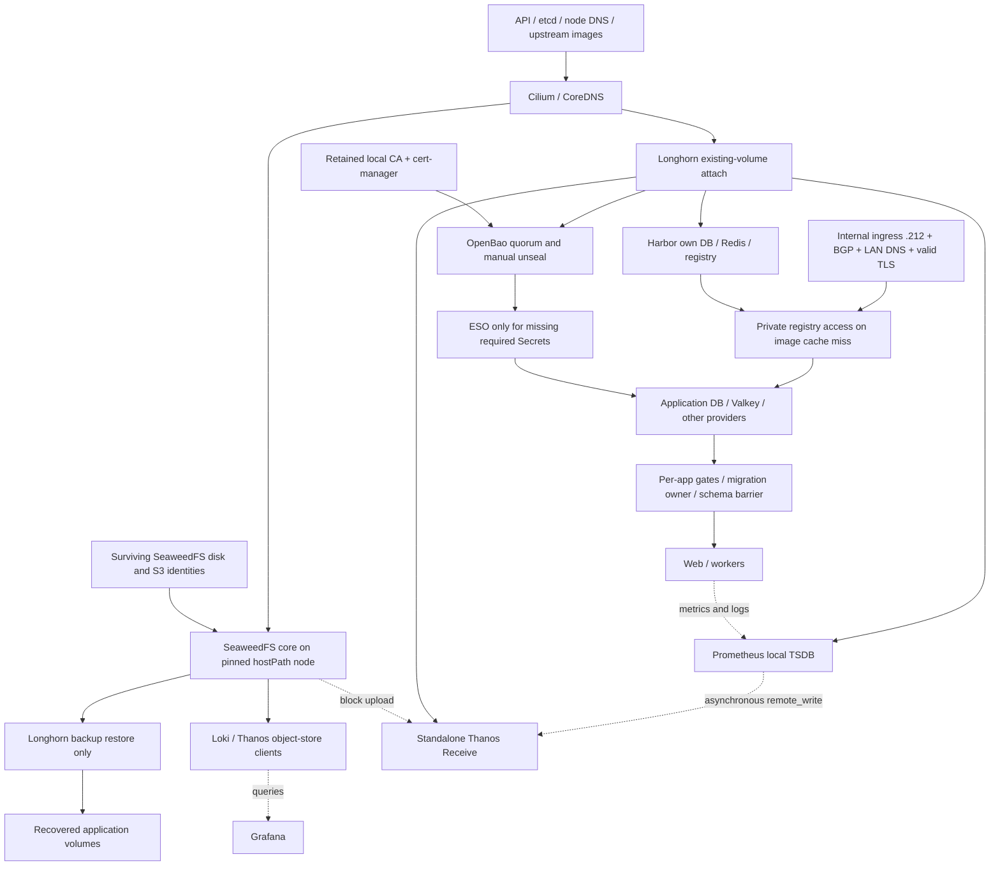

# Cold-start graph after the dependency cutovers

Read-only runtime refresh, 2026-11-14 (Europe/Prague), after `e17fdcfb` and the
explicitly authorized retired-resource cleanup. This document supersedes old
"prepared", "unpublished" and "restore pending" statuses in the historical plans.
No restart, outage injection, Secret deletion or cluster mutation was performed
for this audit. Source/configuration review is not a complete cold-boot rehearsal.

## Current partial order

Provider → consumer; dashed edges are functional access rather than startup waits.

The machine-readable graph retains more specific nodes and edge kinds. It does
not model every infrastructure dependency or every opaque application config.
There is no global controller holding every application until all infrastructure
is Ready. PriorityClasses affect scheduling, not dependencies; deployed gates
hold selected processes after image acquisition and volume mounting.

## Cycles removed and evidence boundaries

| Former dependency ring | Current result | Evidence / remaining limit |
| --- | --- | --- |
| OpenBao → issuing its own backend certificate → OpenBao | Backend local CA/Issuer in cert-manager is independent of OpenBao/public ACME | Certificates Ready; independent recovery of original CA/unseal material is a separate rehearsal |
| Harbor pull → public GeoIP/CrowdSec ingress → infrastructure recovery | Nodes/LAN use internal ingress `.212:443`, split DNS, existing Harbor TLS | TLS/auth/private pull on three nodes was accepted; DNS-01 transition and exact challenge delegation are documented separately |
| Harbor image → SeaweedFS → restore lost Harbor PVCs → Harbor | SeaweedFS core and its init use pinned upstream images; hostPath, no Longhorn PVC | Upstream access or preloaded images and surviving pinned-node disk still required; media-cache image remains Harbor-backed but is not the S3 backend |
| Longhorn restore → public Traefik/GeoIP PVC → Longhorn restore | Direct `http://s3.seaweedfs.svc.cluster.local:8333` | Signed read/list, new small-volume backup and isolated new-PVC restore with matching SHA/size passed; test resources removed, source/backup retained |
| Loki/Thanos S3 access → public ingress | Direct internal S3 for Loki, store, compactor and standalone Receive | Natural Receive compaction/upload and Store Gateway reads verified; legacy sidecar removed |

**No directed cycle remains in the modeled desired graph when the independent bootstrap-image source is available**, including
its image/access/issuance/recovery edges. The historical public-S3 rollback
scenario intentionally still produces a cycle in tests. This is scoped evidence,
not proof that every application's hidden startup behavior is acyclic.

## Remaining risks and missing checks, in recommended order

| Priority | Dependency / scenario | What remains and acceptance criterion |
| --- | --- | --- |
| resolved live; publication pending | Prometheus shared Pod / optional Secrets | Prometheus now runs alone with three optional scrape-token volumes and no S3 mount. History/transition checks passed; user accepted a measured final shutdown scrape tail remaining local only. No-uplink fixtures proved independent startup and auth recovery. Harbor/cache availability for images remains a separate requirement. |
| resolved | Natural Thanos upload and history handoff | Receive natural blocks and Store Gateway reads verified. All36 legacy closed local blocks were accounted for by originals/raw descendants in S3; sampled archive/transition comparisons passed. See the explicit shutdown-tail exception in the cutover protocol. |
| 2 | Recovery trust, identities and storage | Rehearse original CA + matching trust, OpenBao unseal/quorum, Longhorn S3 credential recovery and SeaweedFS S3 identities without depending on unavailable OpenBao. SeaweedFS is pinned to `talos-d4h-k5m`, hostPath `/var/mnt/storage/k8s/seaweedfs`; node/disk loss is availability/data loss, not a dependency cycle. No claim of recovery from an empty machine/disk. |
| 2 | Empty image caches / Harbor TLS loss | Normal persisted TLS and warm-image restart passed, not simultaneous missing Secrets, expired certificate and empty caches. Bootstrap components need upstream registry/DNS access or preloaded exact images. Harbor DNS-01 source now replaces HTTP-01 with an exact challenge CNAME and existing GoDaddy webhook; production acceptance is in the transition record. Public DNS/Internet remain required. Test only in an isolated environment; don't erase live caches/Secrets. |
| 3 | Optional-provider outage/reconnection | Loki cache/S3 outage, Thanos backend loss and Grafana datasources/SSO need an isolated exact-image outage matrix. Mail local fail-closed fixtures passed, but production provider outage was not injected. Karakeep Chrome/Meilisearch replacement recovery and a subsequent full synthetic crawl/search passed; interrupted in-flight job retry and prolonged simultaneous outages remain untested. The startup gate is not continuous worker suspension. |
| 3 | Application features and opaque configs | Open WebUI → Ollama/SearxNG/ComfyUI/terminal, SSO initialization versus login-only behavior, Mastodon search/media, Immich ML, Nextcloud antivirus/Collabora, WordPress external features and Spotify OAuth require functional outage checks. References alone do not justify hard startup gates. Bitwarden login/unlock and Firefox user sync are not established by SQL/heartbeat alone. |
| 4 | Admission and orchestration | Fail-closed cert-manager/ESO/MetalLB/FRR/Longhorn webhooks require their controllers for selected CR writes (Longhorn also PVC admission); inspect rules/groups/operations before interpreting broad resource patterns. No current mutual Pod-startup cycle established. Existing-volume attachment differs from creating/restoring PVCs. Full node/cluster cold boot and new migration execution remain untested. |
| 4 | Matrix stale nginx proxy | Unused API proxy points at Service port6167 instead of8448. Public API bypasses it and worked. Remove/fix separately; no current cycle or public outage established. |

## Gates already covered

* Dawarich, Immich, Nextcloud, Keycloak, WordPress, YourSpotify, Bitwarden and
  Firefox Sync have app-specific DB/cache/provider gates. Native Mastodon has
  PostgreSQL/Valkey → web-owned migrations/schema barrier → web/Sidekiq/streaming.
  Applied-schema/no-op migration acceptance does not prove a future nonempty
  migration or every user-facing feature.
* Mail: Valkey + Unbound + ClamAV → Rspamd → Postfix; Dovecot independently
  provides SASL/LMTP and has **no Valkey dependency**. Production synthetic inbound
  delivery passed; isolated AUTH/AV/filter-down/recovery fixtures passed with
  temporary rejection, preserving filtering policy.
* Karakeep: separate Chrome and Meilisearch → s6 workers. UI/SQLite migrations
  stay independent. Live CDP, worker gate release and established browser
  connection passed. Chrome and Meilisearch replacement recovered without restarting
  the application/worker; a subsequent synthetic crawl, captures, AI and search
  passed and the test bookmark was removed. Meili retained all 396 documents and
  394 vectors. In-flight interruption/retry remains untested. Removed obsolete gate ConfigMap is no longer available
  for historical ReplicaSet rollback without restoring that ConfigMap.
* Seven ordinary custom CronJobs completed real work; safe dependency-failure
  diagnostic skipped without main work. Gates run per execution and do not
  change schedules/suspend. Longhorn controller jobs remain untouched; backup,
  token renewal and safety tasks must fail/report rather than silently skip.

## Current inventory and control-plane checks

Fresh sanitized census: **150 continuous workloads + 30 CronJobs, 54 namespaces,
53 ExternalSecrets**. Previous census was 149 +31; these counts are structural,
not a claim of complete semantic coverage. Scratch report:
`/tmp/startup-reference-inventory-20261114.json` (regenerate using COVERAGE.md).

After separate cleanup of retired PKI resources/three completed historical Jobs
and the unused Karakeep ConfigMap: `tools/ops/verify.py argocd` passed **95/95**,
all Healthy/Synced/unpaused, no orphan warnings. Production Pods retained UIDs and
restart counts. Prometheus and all three Alertmanager replicas reported zero
active alerts after the cleanup silence was removed. This is an operational
baseline, not proof that a stopped cluster can recover unattended.

## Subsequent Harbor/image package

See [DNS-01 execution and rollback](../migrations/harbor-dns01/README.md) and
[bootstrap image recovery](../bootstrap-images/README.md). Exact images have been
preloaded on all three nodes. ArgoCD IfNotPresent and pinned Harbor BusyBox are
prepared source changes, not yet reconciled. The machine-readable graph now
records the independent image source explicitly. If Harbor TLS, solver cache and
that independent source are all unavailable, its Harbor-backed webhook image
creates a **conditional Harbor → webhook → certificate → Harbor access ring**.
This is not solved by pretending a warm cache is permanent. Native durable cache
media and truly empty-node recovery remain separate acceptance work.

## Follow-up: independent Prometheus cutover

The user selected standalone Receive/remote_write. [The transition protocol](prometheus-receive/README.md)
records infrastructure, dual write, the memory/GC correction, full legacy block
lineage coverage, sampled archive/boundary comparisons and the live sidecar
detach. Prometheus now runs alone; three scrape tokens are optional, with auth
failures limited to their scrapes. Receive owns an independent PVC and S3 config.
The user explicitly accepted the final shutdown scrape tail missing from Receive
but retained locally; it must not be described as a lossless handoff. Cutover
source publication and resuming the two Argo apps remain pending. No production
Secret/provider outage was injected; exact-image local failure fixtures passed.
