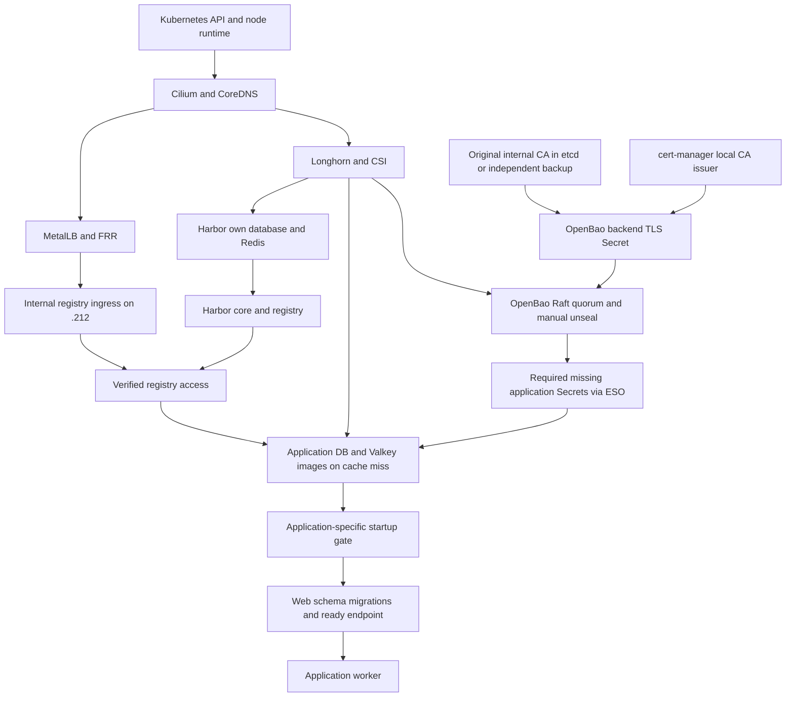

# Startup dependencies and readiness contract

Status: **application startup gates deployed; Mastodon native cutover completed**, 2026-11-13.
Source now covers Dawarich, Immich, Nextcloud, Keycloak, WordPress, YourSpotify,
Bitwarden, Firefox Sync and native Mastodon, plus core bootstrap dependencies.
The [coverage audit](COVERAGE.md) distinguishes detailed stack checks from the
broader structural census. The [native Mastodon plan](mastodon-native/README.md)
records its offline backup/restore validation and controlled source transition.
The [next-steps package index](NEXT-STEPS.md) contains inactive mail, Karakeep
worker, observability S3 and per-Job proposals, their acceptance gates and rollback
boundaries. Nothing in that package is deployed by this preparation.
The machine-readable [graph](dependencies.yaml) records provider → consumer
edges, readiness criteria and source evidence. Phases describe a partial order;
there is no global startup controller or cluster-wide sync barrier.

A broader read-only structural inventory covered **149 live workloads in 51
namespaces and 51 ExternalSecrets**. It records required Secret/ConfigMap/PVC
references, image origins, and literal service-host hints resolved through actual
Service selectors. The local report is `/tmp/startup-runtime-inventory.json`.
Reproduce it without exporting raw environment values or Secret contents:

```sh
kubectl get deployments,statefulsets,daemonsets,services,externalsecrets -A -o json \
  | python3 tools/bootstrap/inventory_startup.py > /tmp/startup-runtime-inventory.json
```

This inventory covers declared references across the cluster; it does not infer
mandatory process dependencies from opaque Secret/ConfigMap content, scripts or
third-party chart internals. Only five workloads expose service hints as directly
parseable literal environment addresses; the detailed graph supplements these
with inspected source for the selected stacks. Do not interpret missing hints as
proof of independence, or expand gates to all referenced services automatically.

## Main graph



External registry/DNS availability or preloaded bootstrap images are prerequisites
for the bootstrap components themselves. They must not wait for Harbor. Secret
materialization requires ESO/OpenBao **only when required target Secrets are
missing**; a normal restart with persisted Secrets does not need to wait for a
fresh ESO refresh. The diagram collapses per-namespace Secret nodes for clarity;
the implementation must never wait for every ExternalSecret in the cluster.

## Criteria, not just process counts

| Provider | Criterion to release its consumer | What is insufficient |
| --- | --- | --- |
| Kubernetes | API usable, etcd quorum, intended node schedulable | One answering API endpoint |
| Cilium/CoreDNS | Intended nodes Ready; target-namespace DNS and service/policy path work | DaemonSet desired count alone |
| Longhorn | CSI/manager available; required volume attaches and mounts | PVC `Bound` alone |
| OpenBao TLS | Original trust retained; backend leaf Secret valid with required SAN/key | Certificate object exists |
| OpenBao | Raft quorum, active leader, required members unsealed, verified internal health | TCP 8200 or Pod Running |
| ESO | Required Secret/keys exist; if absent, its own store and ExternalSecret reconcile | All ESO Pods Ready |
| Harbor access | .212 TLS/SNI, token exchange and authenticated private-image pull | `/v2/` HTTP response alone |
| Application PostgreSQL/MariaDB | Authenticated read-only `SELECT 1` against the configured DB | TCP connect or `pg_isready` |
| Application Valkey | Protocol PING → PONG with configured authentication | Open port 6379 |
| Schema | Application-owned schema/data migrations complete | Successful `SELECT 1` |
| Web | App-specific ready endpoint checks its essential services | Process started |
| Worker | Entry starts after local web/schema barrier; actual worker heartbeat/queues verified at rollout | Web readiness alone |

The generic criteria are design requirements, not a claim that every application
currently enforces them. Required DB usernames, databases and Secret references
must come from each application's actual configuration.

## Application branches verified in source and runtime

| Stack / namespace | Database Service | Cache Service | Additional functional dependencies |
| --- | --- | --- | --- |
| Dawarich | `dawarich-postgres:5432` | `valkey-dawarich:6379` | Photon geocoding; Keycloak login |
| Immich | `immich-postgres:5432` | `immich-valkey:6379` | Separate machine-learning service |
| Mastodon | `mastodon-postgres:5432` | `valkey:6379` with auth | SeaweedFS media; OpenSearch search; Keycloak login |
| Nextcloud | `mysql-nextcloud:3306` | `valkey:6379` | Collabora/antivirus/integrations need separate checks |
| Keycloak | `keycloak-postgres:5432` | No separate Valkey dependency found | Required for SSO feature of consumers |
| WordPress | `mysql-wordpress:3306` | `valkey:6379` | Existing PVC config supplies app credentials |
| YourSpotify (`spotify`) | `ferretdb-postgres:5432` → `ferretdb:27017` | No Valkey | FerretDB → server → web; Spotify API/OAuth functional checks |

Read-only protocol checks for the new PHP gates passed against current Nextcloud
and WordPress SQL/Valkey services. Nextcloud uses ACL user/password and a string
port, both handled without executing config. YourSpotify's current FerretDB deep
endpoint and server root returned HTTP 200; the pinned server bundle calls
`connect().then(() => server.listen(...))`. These checks do not prove the future
init containers have rolled out successfully.
Photon, ML, search and SSO are separate feature edges, not unconditionally global
startup gates. Whether a particular client performs blocking OIDC discovery
during initialization needs a separate check before treating SSO as optional.

## Remaining cycles and bootstrap exceptions

The former conditional **public S3 route / GeoIP-volume recovery ring** is
recorded separately in `recovery_scenarios`. Longhorn now uses the
[direct internal S3 route](../migrations/longhorn-internal-s3/EXECUTION.md), removing
those public-route edges for backup-store access. Signed reads, controller polls
and a small GeoIP-PVC full backup passed; isolated restore remains pending. The historical
public route describes rollback risk. Existing-volume restart does not imply
this recovery scenario.

The [per-Job dependency gate](cronjobs/README.md) is also an inactive proposal.
It does not suspend CronJobs or alter their schedules.

* Ordinary Longhorn volume attachment does not require S3. S3 is needed for backup
  restore. SeaweedFS source now uses pinned upstream images, removing the Harbor
  images → SeaweedFS → Longhorn restore → lost Harbor volumes recovery ring.
  Upstream registry access or preloaded images is still needed on a cache miss.
* SeaweedFS data is hostPath-backed, not a Longhorn PVC. Its storage must survive
  on its pinned node, and S3 credentials must have an independent recovery path.
* Harbor's certificate remains ACME HTTP-01 via public Traefik. A valid persisted
  `harbor-tls` Secret supports normal boot; missing/expired TLS requires the
  public challenge path. The local OpenBao CA does not need GoDaddy or Harbor.
* GoDaddy webhook, snapshot-controller, reporting and housekeeping images in
  Harbor are not prerequisites for local CA signing or existing-volume attach.
* Kyverno resource checks currently use audit/fail-open behavior; do not turn
  signature lookup into a new Harbor/bootstrap admission dependency.

## Dawarich pilot

Observed workload: one `Deployment/dawarich`, ordinary containers `dawarich`
and `dawarich-sidekiq`; dedicated PostgreSQL StatefulSet and Valkey StatefulSet.
Both target ExternalSecrets and their stores reported Ready. The app's current
image includes Ruby 4.0.9, bundled `pg` (libpq 180001) and `redis` 4.8.1; plain
`ruby -rpg` fails, so the candidate uses **`bundle exec ruby`**.

Existing web entrypoint creates a DB if needed, runs `db:migrate`, `data:migrate`
and `db:seed`, then starts Rails. Sidekiq entrypoint only waits for SQL login;
it has no schema barrier. Existing `/api/v1/ready` code checks `SELECT 1` and
Redis PING without depending on a running worker. A read-only request returned
HTTP 200 with `Host: localhost`; the candidate preserves that Host header.

The active Dawarich source and its reproducible candidate add:

1. After the existing volume-preparation init, a same-image init checks the
   configured DB with the existing Secret reference and read-only `SELECT 1`,
   plus Valkey PING. It never loads Rails or runs migrations.
2. PostgreSQL and Valkey must pass in the same iteration. Each operation is
   bounded to 5 seconds and each gate invocation to 300 seconds, retrying every
   5 seconds. Logs contain only fixed stage/result names and elapsed time.
3. Web keeps its original entrypoint and migration/seed behavior. A readiness
   probe uses its actual `/api/v1/ready`, not a guessed endpoint.
4. The Sidekiq command waits for that endpoint on **localhost**, then `exec`s
   its original entrypoint. Waiting via the Service would deadlock: the Pod's
   web readiness may not be enough to publish a Pod with a waiting worker.

Render for review outside the repository:

```sh
python3 tools/bootstrap/prepare_startup_gate.py --output /tmp/dawarich-startup-candidate.yaml
```

The default output contains a ConfigMap and the modified Deployment only,
**not the full application**, and stays outside the repository. An explicit
`--write-source` updates the two active `dawarich/` files locally; `--check`
verifies those files and is included in CI. The generator never contacts
Kubernetes. `dawarich/config-map-startup-gate.yaml` and the Deployment are now
included by the existing directory-based Argo application. A script checksum in
the Pod template makes later script changes trigger a rollout. DB/cache manifests and NetworkPolicies
are preserved; init uses the same Pod labels and existing allowed service paths.

Init waits delay application processes, not Pod creation, image acquisition,
networking or volume attachment. A failed gate exits nonzero; Kubernetes retries
it with backoff, so 300 seconds bounds one invocation, **not the whole Pod's life**.
The worker may similarly restart while a long migration is still running. This
does not re-arm a gate when an individual main container restarts in a surviving
Pod, and cannot guarantee dependency availability after the initial check.

No schema version check is added: the existing web migration owner remains
authoritative. Parallel replicas/multiple migration owners need a separate design;
the current single-Pod `Recreate` arrangement is the pilot boundary. Avoid DB/cache
liveness checks in the web process that would cause restart storms during outages.

## Verification and future rollout gates

Local tests cover SQL/auth failure, Valkey failure, timeouts, recovery, resource
cleanup, JSON log sanitization, the web barrier, graph references/acyclic normal
startup edges and preservation of the original workload. They do not prove an
actual staged cold boot. No DB/Valkey was stopped and no Secret was deleted.

CI restores Ruby in the CodeQL matrix (`build-mode: none`). The validation job
explicitly installs `/usr/bin/ruby` and syntax-checks repository `.rb` files before
running the unit suite, so Ruby behavior tests (including the existing Mastodon
importer tests) cannot silently skip because the interpreter is missing. Local
CodeQL analysis was not run; its result requires publishing the workflow changes.

After the user publishes this reviewed source, observe Argo synchronization,
init dependency checks, web migrations/readiness, then worker startup and normal
queue behavior. Production fault injection is not authorized: test provider
unavailability and recovery in isolation before broadening this pattern. The production application uses `Recreate`,
so rollout causes a short app outage. Roll back by restoring the original
Deployment command/probes/init/volume configuration, then retiring the unused
ConfigMap through its owner. No DB restore or data deletion belongs in rollback.

Argo waves order sync operations, not reboot of existing workloads. The current
Argo source does not provide an Application health customization for app-of-apps
dependency waiting. Strict cluster-wide startup with no dependent Pods requires
separate orchestration and reconciliation rules; this pilot intentionally does
not pretend to install it.

## Five-stack gate package (local preparation)

| Consumer | Sequential startup checks | Readiness/migration ownership |
| --- | --- | --- |
| Immich server | existing prepare-library → PostgreSQL SELECT 1 → Valkey PING | Existing Immich entrypoint owns migrations; ML is not a gate |
| Keycloak | PostgreSQL SELECT 1 replaces open-port loop | Existing Keycloak startup/ready/live endpoints retained |
| Nextcloud web | MariaDB SELECT 1 → Valkey ACL PING | No `occ upgrade` or PHP bootstrap in gate |
| WordPress PHP/nginx | MariaDB SELECT 1 → Valkey PING | No WordPress bootstrap or writes in gate |
| YourSpotify | PostgreSQL → FerretDB deep ready → server HTTP 200 → web | Server retains its own authenticated Mongo connect; ongoing health is separate |

`tools/bootstrap/prepare_application_gates.py --check` checks committed-source
consistency. `--write-source` regenerates only local gate ConfigMaps, init
containers, script checksum and FerretDB readiness; it makes no Kubernetes calls.
Nextcloud gates request 64Mi to satisfy its namespace LimitRange; the other four
stacks require at least 32Mi. A regression test checks gate requests against the
tracked namespace minima before rollout.
Native clients use already pinned images from each stack; no package installation
at startup. ConfigMaps contain scripts only. PostgreSQL passwords stay Secret
refs. PHP gates read the existing PVC read-only and parse literal config with
`token_get_all`; no include/eval, application bootstrap, credential output or
persisted credential copies. Dynamic/unsupported config fails closed. Nextcloud
ACL auth is honored. Nextcloud/WordPress SQL checks use read-only transactions.

Each invocation has a 300-second retry budget, with operations limited to 5 seconds
(plus at most one second to terminate); an in-flight operation can finish just
after the budget. Kubernetes retries failed init containers;
this is not a permanent 300-second cutoff for the Pod. Logs contain only fixed
stage names, ready/waiting/timeout and elapsed duration. PHP/Node tests are required
in CI, together with existing Ruby coverage; JavaScript is included in CodeQL.
The FerretDB readiness change checks the backend; liveness remains TCP to avoid
restarts on an upstream database outage. Its [deep endpoint contract](https://docs.ferretdb.io/v2.5/configuration/observability/)
is distinct from liveness.

These gates delay ordinary app containers, not Pod creation, scheduling, image
pulls, PVC attachment or admission. They do not continuously stop an app after a
later dependency outage and do not impose a barrier across Argo Applications.
No global sync-wave or priority changes are added. The SQL check is not schema
readiness; existing app entrypoints retain migrations. YourSpotify web gate waits
only for its internal API, not external Spotify, ingress or SSO.

Roll out one stack at a time after publishing and green CI. Observe init stage
logs → app startup/migrations → readiness → functional request, then continue.
Stateful/Recreate apps can have a brief outage. First Nextcloud/WordPress install
without populated PVC config is outside this restart template's scope.
Rollback: revert this package's workload changes (retain any later image/security
updates), sync the previous workloads through Argo, then remove unused script
ConfigMaps. No database/PVC/Secret changes need reverting; no data is deleted.
Do not force restarts or failure injection on live databases for verification.

During a rolling update, a Service gate can be satisfied by an older healthy
replica. This checks dependency availability, not completion of a particular new
ReplicaSet or cross-Application rollout ordering. A successful warm rollout is
not evidence of a full cluster cold boot.

## Mastodon native deployment

The [native package and transition/rollback plan](mastodon-native/README.md)
was activated on 2026-11-13 after the requested background Job completed and an
offline encrypted backup passed isolated restore validation. Web init owns full
migrations; web/Sidekiq/streaming check both ordinary and post-migration IDs under
a PostgreSQL advisory-lock barrier. Initial adoption was a no-op for the schema.
Future pending migrations and version changes still require a maintenance window.
