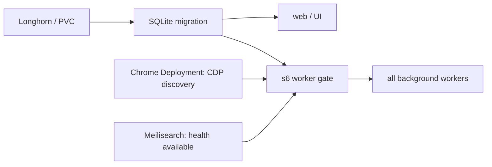

# Karakeep startup and separate Chrome

Prepared locally; **not deployed**. The user accepted waiting before the whole
worker pool and requested a separate Chrome Pod where compatible.

## Dependencies and readiness

Chrome uses the existing exact image, arguments, UID 65534, capability drop,
read-only root and temporary-volume limits. Its upstream entrypoint forwards
9222 through socat to Chrome on localhost:9223. It already supports remote
connections; Karakeep 0.34.1 resolves the browser hostname before Patchright CDP.
Local testing with two separate containers proved CDP and synthetic DOM access.
No upgrade, custom browser image or extra proxy is required.

The new ClusterIP Service is `chrome.karakeep.svc.cluster.local:9222`.
Default deny remains effective; new paired NetworkPolicies permit CDP only
from `app=karakeep` to `app=karakeep-chrome` in this namespace. Chrome inherits
existing namespace DNS and HTTP/HTTPS egress, but receives no Karakeep Secrets,
PVC, service-account token, ingress, public VIP or route. The web Service selector
cannot select the browser Pod.

The gate replaces only `/etc/s6-overlay/s6-rc.d/svc-workers/run` with an immutable
versioned ConfigMap. The upstream entrypoint, migration dependency and web runner
remain intact. It checks Chrome `/json/version` and nonempty debugger URL plus
Meilisearch `/health` JSON `status=available`, using bounded parallel HTTP requests
and a five-minute wait budget. On expiry it exits 75; s6 retries only workers.
On readiness it execves the original worker process, preserving signals.

All crawler/search/inference/other workers wait together. Ollama and Keycloak
are not unconditional startup gates: they serve AI and login respectively.
SQLite migration readiness belongs to existing s6 ordering, not a separate DB
Deployment. There is no dependency from Chrome/Meili back to workers or web.
After startup, existing application reconnection/retry handles provider loss;
this gate does not continuously stop already-running workers.

## Local validation

* Native HTTP unit cases cover wrong status/JSON, redirects and stalled replies.
* `python3 tools/security/test_karakeep_worker_startup.py` uses the production
  Karakeep image, no network uplink, empty disposable SQLite and fake providers.
  Migrations/web run with providers down; Chrome alone cannot release workers;
  both providers release the real worker executable. Graceful s6 stop passes.
* `python3 tools/security/test_karakeep_remote_chrome.py` uses both declared images
  in a private no-uplink Podman network. The actual Patchright client connects
  remotely, creates a synthetic page, reads its title and disconnects.
* Manifest tests cover canonical script projection, distinct Service selectors,
  same-namespace policy peers, port restriction and browser separation.

Requires Podman, Python/PyYAML and existing registry access to the declared
images. These opt-in integration scripts create/remove only their own local
containers, temporary files and network. They never use production Secrets/data.
Real cluster DNS, policy enforcement, new browser volume ownership and a real
bookmark crawl must still be verified after deployment.

## Transition

1. Before publication retain the current Git revision (`c12103fd`) as rollback
   reference. No database changes or task requeue are required.
2. Publication permits ordinary Argo reconciliation. Before the authorized
   rollout, create short, narrowly scoped maintenance silences for affected
   Karakeep/Chrome Pod alerts only, recording IDs/expiry; remove after checks.
3. Argo creates the Chrome Deployment/Service/policies and replaces the Karakeep
   Pod using its existing Recreate strategy. Brief UI interruption is expected.
   Resource ordering is safe even if web starts first: only workers wait.
4. Verify Chrome startup/readiness, writable temporary paths, Service endpoints,
   namespace policy reachability and CDP from web. Check Meili readiness.
5. Confirm logs show migration completion, then worker dependency `ready`, then
   workers. Confirm UI, SSO, existing bookmark/search and a user-authorized
   synthetic bookmark crawl, screenshot/PDF/archive. Do not mutate existing
   bookmarks merely for verification.
6. Verify Argo Synced/Healthy, zero recurring gate failures, no new alerts and
   remove maintenance silences. Do not treat Pod Ready alone as functional proof.

## Rollback

Prepare a focused Git revert of only this Karakeep package and publish through
the usual user push. Restore the old sidecar, writable-path init mounts, localhost
BROWSER_WEB_URL, original s6 worker runner and volumes together. The web Deployment
uses Recreate; do not run two writers against its SQLite PVC. Keep all Secrets,
PVCs, bookmarks and Meili data. Do not roll back unrelated later changes.

First restore and verify the sidecar-based Pod. Then explicitly remove only the
now-unused separate browser Deployment/Service/policies and gate ConfigMap if
necessary: this Argo Application does not enable automatic prune. Their temporary
continued existence does not receive traffic after localhost is restored.
Never delete old projected ConfigMaps until no running Pod references them.
