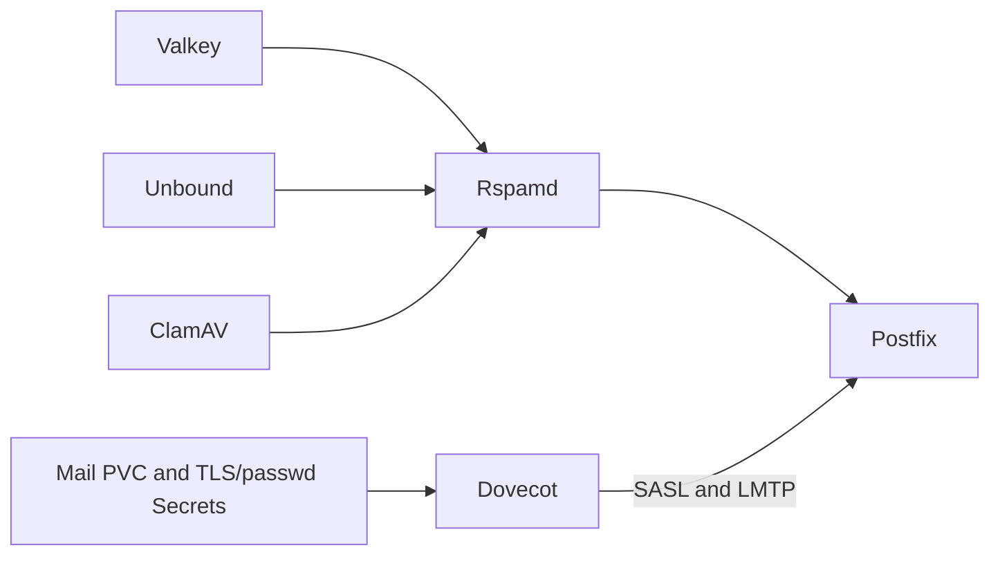

# Mail startup, readiness and failure policy

Status: **32517070 deployed automatically and verified**. The user selected
automatic rollout without the planned SMTP stop. See the [execution record](EXECUTION.md).
A local diagnostic-loop follow-up is prepared, not yet published; queue/mailbox
mounts, TLS, credentials and application entrypoints remain unchanged.

## Verified dependency graph



Dovecot uses local passwd-file authentication, static userdb and local mbox
storage. Source and effective `doveconf -n` contain no Redis/Valkey backend;
existing NetworkPolicies do not allow one. Adding a Valkey wait would introduce
a false dependency. IMAP should remain available when filtering is unavailable.
Rspamd uses Valkey for statistical/history/greylist/neural state, dedicated
Unbound DNS and ClamAV. Postfix has no direct ClamAV client: antivirus is reached
through the Rspamd milter. Postfix also requires Dovecot for submission SASL and
local LMTP delivery. Postfix can normally queue deliveries while Dovecot is
offline; this readiness contract deliberately publishes SMTP/submission only
when both SASL and LMTP are usable. Existing accepted spool is retained.
Existing required Secrets and PVC/image prerequisites remain
implicit Kubernetes prerequisites; no new requirement to wait for an ESO refresh
when its target Secret already exists.

The provider processes do not wait for consumers. In particular the retired
`wait-for-redis-shutdown` init is removed from mail Valkey; the old Redis Service
is absent. Valkey Service/StatefulSet retain their existing wave -1. Rspamd stays at wave 0 and Postfix Deployment uses
wave 1, so Argo waits for the new healthy filter before recreating SMTP. Consumer
gates live in Pod init, not a cross-application Argo health barrier. No dependency
of Dovecot on Postfix/Rspamd/Valkey, and no Postfix→Rspamd→Postfix cycle is added.

## Readiness contracts

| Consumer | Required read-only proof |
| --- | --- |
| Rspamd init | RESP PING/PONG from configured unauthenticated Valkey, DNS TCP localhost A response from Unbound, NUL-framed ClamAV PING/PONG |
| Rspamd runtime readiness | Same provider checks plus local HTTP200 `/ping` and milter option negotiation/QUIT |
| Postfix init | Rspamd milter option negotiation/QUIT, Dovecot LMTP220/QUIT/221, SASL VERSION/MECH/DONE handshake without AUTH |
| Postfix runtime readiness | Same dependencies plus the existing local `postfix status` |

Probes use the same Rspamd/Postfix images and built-in Perl, sockets and
`/proc/uptime`; no installation, new helper image or API token. They do not
submit messages, recipients, scans or passwords, read mailboxes, or log responses
(including the SASL server cookie). Native protocol checks passed from both
current live containers through stdin without writing files or changing config.

Init retries for a 300-second monotonic budget, then fails; kubelet retries it.
It never starts the main service on timeout. An outer timeout bounds even stuck
resolver/library calls to 305 seconds plus 1-second kill grace. Readiness runs
once, with 1-second per-probe alarms, an 8-second outer timeout and 1-second kill
grace inside kubelet's 10-second exec timeout. Failed readiness withdraws Service
endpoints and recovers automatically. Liveness remains daemon-local, avoiding
restarts caused by a provider outage. Endpoint propagation is not instantaneous
and does not terminate existing SMTP/milter connections.

## Approved runtime failure policy

User approved temporary deferral instead of bypassing a failed filter:

* `milter_default_action = tempfail` replaces accept for unavailable Rspamd.
* `force_actions` forces `soft reject` for the antivirus `CLAM_VIRUS_FAIL` symbol.
  Existing `reject` and `soft reject` actions are honored; a positive virus
  detection retains its existing reject policy.
* Existing scanner size/type limits, Redis cache settings, relay restrictions,
  DKIM keys and credentials are unchanged. This is not a claim that every MIME
  byte is scanned or that every DNSBL/Redis module error becomes a 4xx response.

SMTP peers get a temporary failure and can retry. Already accepted mail remains
on the persistent Postfix spool; there is no purge, requeue or deletion step.
A startup gate alone cannot protect a later outage; readiness and the explicit
milter/antivirus policies address different parts of that behavior. See primary
[Postfix milter documentation](https://www.postfix.org/MILTER_README.html),
[Rspamd antivirus](https://docs.rspamd.com/modules/antivirus/) and
[force actions](https://docs.rspamd.com/modules/force_actions/).

Native Rspamd UCL parsing accepted the rule during preparation. Full configtest
through stdin was unsupported because of mmap; after rollout, the actual mounted
config passed native `rspamadm configtest -s`. Isolated SMTP failure injection
and authenticated delivery remain unverified; no production provider was stopped.

## Local validation and source regeneration

```sh
python3 tools/bootstrap/prepare_mail_gates.py                 # check
python3 tools/bootstrap/prepare_mail_gates.py --write-source  # local edits only
perl -c tools/bootstrap/mail_dependency_gate.pl
python3 -m unittest discover -s tests -p 'test_mail_dependency_gates.py'
```

`prepare_dependency_batch.py --package mail` now renders this same canonical
package rather than proposing the retired narrower Valkey-only adapter. The unused
`mail_valkey_gate.sh` and its client-stub tests are retired; real wire tests now
cover PONG, NOAUTH, truncated replies and hung reads for Valkey and ClamAV. CI
checks canonical sources, Perl syntax, fake wire-protocol failures and recovery.
Immutable content-addressed script ConfigMaps must remain while referenced.

## Reference staged rollout — not used for 32517070

Do not publish the entire active-source package and assume a zero-downtime
upgrade: mail uses single-replica Recreate deployments; removing the Valkey init
also rolls its StatefulSet. Reloader reacts to ConfigMap changes. A controlled
transition must prevent new mail being accepted under the old accept policy
while providers are being restarted.

1. Before publication/rollout, approve a short SMTP maintenance window, a scoped
   mail Argo pause, stopping only Postfix ingress by scaling its Deployment to 0,
   and restoring it through GitOps. Dovecot stays running. The first transition
   commit must temporarily keep `mail/deployment-postfix.yaml` replicas at 0; the
   steady-state package prepared here has 1. Inspect queue counts,
   PVC health, current TLS/Secret references, and record the previous revision.
   Do not export mail, credentials or private keys without separate approval.
2. Create narrow time-limited silences for affected mail resource alerts; keep
   an exact list and remove them after verification/rollback. With Postfix down,
   existing senders must retry or use the secondary MX. Persistent spool stays
   mounted, with no queue deletion or forced reprocessing.
3. Publish/reconcile only the reviewed mail package **with the temporary desired
   Postfix replica count 0**; verify new script ConfigMap
   exists before new Pods. Allow Valkey to complete its rollout, then confirm
   Rspamd waits for all providers. Postfix remains stopped by the published
   desired count while policy validation is performed. Restore original Argo
   automation settings after that transition source is accepted.
4. Run full `rspamadm configtest -s` on the resulting mounted config, inspect
   `postconf` selected policy values, ready endpoints and unchanged credentials/
   volumes. Keep Postfix stopped until the following isolated checks pass.
5. Test temporary filter loss in an **isolated test Pod/namespace**, not by
   killing live services: healthy path, milter absent→4xx, scanner failure
   symbol→soft reject, positive virus result→reject, and recovery. Ensure no
   SMTP 250 acceptance is reported for the tested filter-failure paths. Verify
   queued mail remains intact.
6. After those checks pass, restore Postfix to 1 in a second reviewed/published
   change; its init must wait for milter/LMTP/SASL. Test real controlled inbound/
   submission→LMTP delivery only with explicit test-message authorization. Do
   not read unrelated mailbox data. Confirm queue integrity and remove all
   maintenance silences.

## Rollback

Keep the previous Git revision and deployment settings. If a gate blocks mail,
inspect its fixed stage event before changing anything. Roll back just the
consumer init/readiness/code-mount changes through GitOps if necessary, keeping
queue/mailbox mounts, Secret references and local liveness untouched. Do not
restore the obsolete Redis wait or revert the approved tempfail/antivirus policy
to accept as an implicit rollback. Repair the provider instead; changing the
approved filter-failure policy again requires an explicit decision. Never delete
PVCs, mail files, spool entries, DKIM/TLS keys or an active Job as rollback.

## Preparation evidence

Published CronJob follow-up `37c98bdd` was adopted by all affected applications.
The scheduled media CronJob now references its tested script ConfigMap; deleting
only the explicitly authorized completed skip diagnostic cleared monitoring's
last two orphans. No working resources were removed. Nextcloud's existing
retired PKI Role/RoleBinding drift remains unrelated and untouched.

Mail native probes passed from existing containers; batch native UCL parsing
accepted the proposed antivirus failure rule. A comparison with the published
sources confirmed unchanged images, entrypoints, data/Secret mounts, resources
and daemon-local liveness; the only existing policy delta is milter tempfail,
plus the new force_actions rule. Final mail Pod UIDs stayed unchanged, all their
restart counts were 0, and the read-only Postfix queue count was 0.

Local validation includes protocol/failure/recovery fixtures, full repository
unit tests, acyclic graph checks, native Perl syntax, Ruff/Pylint/Bandit and
runtime contracts. Argo render of mail with namespace defaults has 12 containers
and 0 resource errors; Kubernetes schema validation has 177 valid resources,
10 skipped CRDs and 0 errors. These are preparation checks, not a deployed-mail
or SMTP failure-injection success claim.

Final regression run: **744 tests passed, 21 skipped**. Two retired shell-adapter
tests were replaced by seven protocol-level mail tests, preserving PONG/NOAUTH/
timeout checks and adding DNS, milter, SASL, LMTP, partial-frame and recovery cases.
