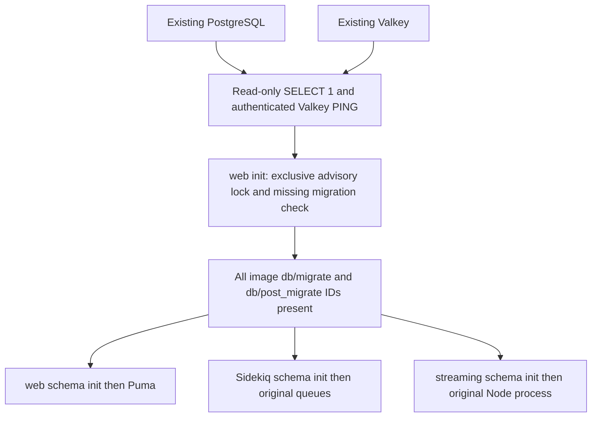

# Native Mastodon: inactive preparation

Status: native cutover completed, 2026-11-13. Source-switch commit f4a35a57 passed
all CI and Code Scanning and was manually synced without prune/force. Native
Deployments are active; the initial migration owner reported `already_applied`
(no db:migrate child and no schema changes). The following Git revision restores
normal auto-sync/self-heal; it does not change native Pod templates. No Replace or
prune is enabled. `mastodon-custom` retains external infrastructure ownership.
The adjacent manual Application remains a reference for a controlled future
transition, not the final steady-state policy.

The user-requested bookmarked-media-sync Job completed successfully before
shutdown. All three app Deployments were stopped before the final encrypted
logical backup. Age authentication and archive catalog checks succeeded; full
pg_restore in an isolated RAM-only PostgreSQL succeeded and counts of five
control tables matched the stopped source. The temporary restore Pod was removed;
production PostgreSQL/Valkey and their PVCs were never stopped/restored/rewritten.
An earlier live snapshot was discarded/replaced and was not used for the cutover.

Read-only post-cutover acceptance: web/API, streaming, login page, OIDC discovery,
existing public media HEAD and both Prometheus exporters returned HTTP200;
Sidekiq heartbeat was current, queues empty, all app init exits0 and restarts0.
Both CronJob suspend flags were restored to false and companion reconciliation
resumed. This does not claim authenticated SSO completion or a test federated post.

## Startup and migration contract

Only `mastodon-web` contains `migrate-schema` and `MASTODON_MIGRATION_OWNER=web-init`.
All three roles first check PostgreSQL and authenticated Valkey, then check every
migration ID from the exact pinned web image. Streaming uses that Ruby image only
for init; its ordinary container remains the existing Node streaming image.
`schema_migrations` may contain additional historical IDs removed from the source;
all IDs still present in both image directories must be recorded.

Read-only schema gates briefly acquire a shared session advisory lock; the owner
uses an exclusive lock on the same key, `901746283`. It is an application-specific
coordination key, not a table/object or Kubernetes permission. Concurrent new
owners serialize and recheck the schema. Only the owner can spawn fixed argv
`bundle exec rake db:migrate`, with `SKIP_POST_DEPLOYMENT_MIGRATIONS` unset.
There is no shell, PreSync/PostSync Job, completion ConfigMap, Kubernetes API call,
new database table or Kubernetes RBAC. A missing/empty `schema_migrations` blocks;
this package never runs db:create, db:prepare, seeds or down migrations.

Initial write policy is `MASTODON_ALLOW_PENDING_MIGRATIONS=false` on web's migration
init. Unexpected pending IDs therefore block rather than silently changing the DB.
A future version's reviewed maintenance commit must explicitly set that init's
literal policy to `true`; the generator preserves and validates this explicit
setting. After accepting the upgrade, restore `false` through Git (this restarts
web once, with no pending migrations). The flag is not a secret or a permission
boundary; it prevents accidental automatic image updates from starting DB writes
without the planned maintenance process.

Already-applied migrations are a no-op: the writer command is not started. On
2026-11-13, read-only inspection found **615 required IDs, zero missing** for the
currently running image. The exact dependency probe succeeded. This predicts a
no-op first cutover; it is not evidence that future migrations have been tested.
When schema is already ready, consumers can pass before web emits its no-op log:
the barrier is schema state, not an arbitrary Pod/Job generation or web readiness.

Checks use bounded operations (5 seconds), a 300-second dependency retry budget,
a 1800-second schema retry budget, and a 1800-second owner lock/migration budget.
They retry as init containers after failure; they do not impose an overall Pod
lifetime limit. Writer heartbeat monitors the coordinator session; timeout,
connection loss or termination kills/reaps the child process group before closing
the session/lock. Logs contain only fixed stage/result/duration/numeric exit code;
raw migration/driver output is suppressed because it can contain credentials.
Only the migration init disables Prometheus instrumentation so Rails cannot wait
on the ordinary same-Pod exporter before init has finished; main processes keep
all existing instrumentation settings.
A zero child exit still requires all migration IDs before any gate can pass.

A full migration requires an offline maintenance window on every version change.
Recreate alone does not stop older Sidekiq/streaming in other Deployments. Existing
running Pods do not acquire this new lock, nor do old CronJobs: operators must
stop/drain them before a writer is allowed to run. This is not a rolling pre/post
migration strategy and has no zero-downtime promise. On an ordinary same-version
cold restart, gates work without an Argo sync or a surviving completed Job. They
cannot delay scheduling, image pulls, network attachment or PVC mounting.

## Preserved integration and ownership contract

Names, immutable Deployment selectors, Service selectors/ports and Pod labels
stay the same. `mastodon` remains the owner of its three application Deployments,
two Services, environment ConfigMap and ServiceAccount. `mastodon-custom` keeps
PostgreSQL, Valkey, PVCs, ESO/SecretStores, ingress/TLS, middleware, network policies,
CronJobs and their RBAC. The native package contains no Secret, PVC or Role object.

The web/worker/custom exporter image remains build `2026-11-09-022903`, pinned to
running digest `ee235351bb9d0426060f01dbb3e0c2c4d9dd2a134f178b74e8bd5f108083693d`;
streaming remainsv4.7.5, digest
`3859d071e61a0ed2610a00e8048d89310235afb86e6923c0243bb4f9f4a31093`.
Pinning does not upgrade the application. Preserve this version separation until
cutover is verified; subsequent image updates are a separate maintenance task.

Preserved: PostgreSQL/Valkey endpoints and Secret key refs; S3/SeaweedFS bucket,
endpoint/alias; SMTP TLS settings and hostAlias; Keycloak OIDC issuer/client refs,
callback and existing auth flags; OpenSearch; domain/5000-char customization;
Sidekiq concurrency25 and all weighted queues; web and Sidekiq Prometheus settings,
the uncapped exporter; probes, resources, security contexts and service discovery.
Probe security and database schema readiness are different: Sidekiq originally has
no readiness probe, so verify its heartbeat/queues after process startup.

Intended changes: init/schema coordination; reviewed image digests; Recreate;
disabled unused ServiceAccount token; script/env/image checksum; no Helm hooks.
Migration init requests512Mi/100m, limit1536Mi; probes64Mi/10m, limit256Mi. These
fit the observed namespace minima32Mi/10m and maximum6Gi. Existing app resources
and probes remain intact. Script changes roll the native Pods only after activation.

## Local checks and CI

`python3 tools/bootstrap/prepare_mastodon_native.py --check` verifies generated
script/config checksums and init contracts. `--write-source` updates only inactive
native files; `--output /tmp/unique-directory` emits a private CI scope. No Helm or
cluster call is made by this tool. The native manifests are canonical, not a
runtime chart dependency; legacy values remain only for rollback/comparison.

CI checks Ruby syntax/unit failure paths and renders the native source. The source
switch retires only the one-time automatic Helm parity invocation (which passed
for ef1dfcd3), avoiding a meaningless native-to-itself comparison. The comparison
tool remains available for an explicit rollback review; ownership/integration,
schema and resource regression tests remain. A source-policy test now requires
native Git source with self-heal after acceptance and rejects Replace/prune automation.

Tests cover PG auth/Redis failure, missing post-migrations, held writer locks,
missing/empty schemas, only one migration owner, no-op current schema, child errors,
bounded timeout, coordinator loss, child cleanup and log sanitization. A fixture
runs the real child-management code with an isolated fake bundle command. No
production migration or database outage is injected.

## Transition plan — future separately authorized operations

1. Publish this inactive preparation and require green CI/Code Scanning. Review
   the chart/native parity report and pinned images. Confirm current DB/Valkey,
   required ESO targets, S3, OpenSearch, OIDC, mail and app behavior. Record source
   revisions, replica counts, image digests and relevant controller settings.
   Establish an independent database backup and an isolated restore procedure;
   backup freshness alone does not prove restorability. Do not export Secrets.
2. Obtain the maintenance execution authorization. Pause reconciliation of both
   `mastodon` and `mastodon-custom`; the latter otherwise reverts manual CronJob
   suspension. Preserve their exact original settings. Suspend only the two current
   namespace CronJobs, `bookmarked-media-sync` and `mastodon-spam-list-sync`, record
   original suspend flags (currently both false), and wait for active Jobs to drain.
   Check for any other DB writers before proceeding; do not delete active work.
3. Stop/drain web, Sidekiq and streaming, verifying no old app Pods/Jobs remain.
   Keep PostgreSQL and Valkey running and their PVCs/Secrets untouched. Record queue
   backlog. Do not treat a controller replica setting alone as proof processes exited.
4. Prepare/publish the separate Argo source-switch commit based on the adjacent
   manual Application proposal, same app name and namespace. Remove Replace;
   do not enable prune. Retire the temporary chart-parity CI step in that activation
   commit while retaining native tests/schema/resource checks. Keep the application
   paused until the desired Git source is confirmed; do not run Helm uninstall.
5. For first adoption keep the write policy false. For a separately approved
   version upgrade, allow pending migrations only after all old writers are drained.
   Unpause only `mastodon` with manual sync policy, and perform the separately
   authorized native sync without prune. This activates init migration ownership;
   do not try to run the new init before its native workload is installed. Observe
   PG/Valkey gates → exclusive owner lock/no-op or full migrations → schema gates →
   ordinary web/Sidekiq/streaming processes. First cutover should log already_applied.
   If actual migrations are unexpectedly needed, the false policy blocks the writer;
   stop and review before publishing an explicit write-policy change; verify pending count immediately before sync, not just today's snapshot.
6. Verify startup logs/exit codes, all required schema IDs, web/streaming health,
   exporter scrape, Sidekiq heartbeat/queue handling, ingress/SSO, existing timeline
   and media access. Authenticated reads require authorized credentials; test posts,
   mail or federation writes require their own approval. Ready alone is insufficient.
7. Restore exact CronJob flags and `mastodon-custom` reconciliation, then desired
   normal Mastodon automation through a reviewed Git change only after acceptance. Leave completed old chart hooks
   and predeploy resources inert until separately reviewed cleanup; don't delete
   working resources or adopt them under a second app. Recheck all Argo conditions.

The repository prohibits kubectl apply and git push by the agent. This document
specifies operations/evidence, not authorization to execute maintenance. No blanket
source switch, scale, restart, backup write or database operation is authorized by
local preparation. Publication of the source-switch changes the definition only; manual sync remains required.

## Rollback

Before actual schema changes (including the expected no-op first cutover), pause
both app controllers, suspend/drain writers, stop native app processes and restore
the previous Helm+values source1.2.8 under the same app name with prune disabled.
The rollback Git change must also restore the Helm repository in the applications
AppProject source allowlist (removed when switching to the Git-only native source).
Reconfirm that legacy image tags still resolve to the recorded running digests;
otherwise prepare reviewed pinned overrides. Restore the known replica counts,
CronJob flags and controller settings after the old workloads and functional
checks pass. Keep the unused startup ConfigMap until nothing references it. No DB
restore or PVC/Secret deletion belongs in this application-source rollback.

After migrations actually change schema/data, old-image/source rollback is **not
automatically safe**. Halt writers and review migration compatibility first;
prefer a reviewed forward fix. Never automatically run down migrations. Restoring
a database requires an independently verified backup/restore plan and explicit
approval for its data-loss window. A failed migration blocks new starts; Kubernetes
may retry the init, so stop the rollout/writer before investigating a failure that
could be non-transactional. No rollback scenario deletes production storage.
