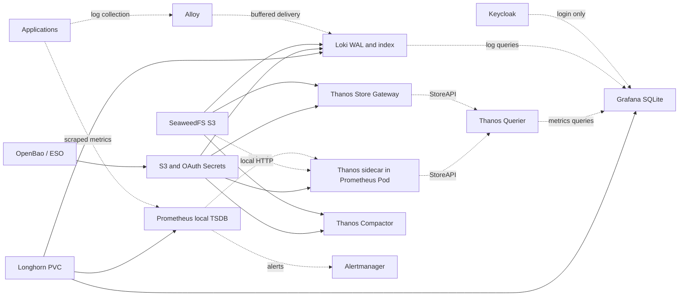

# Observability recovery dependencies

Initial read-only audit on 2026-11-14, followed by the explicitly authorized
[executed internal-S3 transition](EXECUTION.md). Runtime is now on internal S3;
matching source `02ea6103` was published, reconciliation restored and current
Argo baseline is Healthy/Synced. See the [current audit](../AUDIT-2026-11-14.md).
The user treats Loki/Thanos/Grafana as optional to the functioning cluster.
Do not add application startup gates on any of them.

## Actual graph

Solid edges are required storage/startup dependencies; dashed edges represent
queries, delivery or optional features, not an instruction to wait at startup.



No observed strict Loki/Thanos/Grafana startup cycle exists. Grafana has no
provider wait init, uses a local SQLite PVC, and its provisioned default metrics
source is Thanos Querier. Sources can fail independently while the UI starts.
Grafana health returned database=ok. Additional UI-managed sources were not
inventoried; the mounted provisioning ConfigMap alone does not inventory SQLite.

Loki is a single binary with independent chunks/results Memcached caches,
gateway and canaries. It has no init wait or liveness probe for external services.
Cache addresses are configured clients, not mutual startup gates. Real cold
outage/retry behavior remains to be exercised in isolated exact-image tests.
Loki's pre-cutover ConfigMap used `https://s3.andreybondarenko.com`. The active
route now bypasses those public DNS/TLS/Traefik dependencies via
`s3.seaweedfs.svc.cluster.local:8333`; bucket/schema/credentials/retention stay intact.

Thanos Querier connects to sidecar and store gateway; it does not access S3 or
need Grafana/Loki. Store and compactor need S3. Prometheus collects and evaluates
its own alert rules without Grafana/Loki/Thanos Query, but there is a shared-Pod
failure domain: a failed sidecar readiness removes the entire Pod from ordinary
Prometheus Service endpoints. The mandatory objstore Secret volume also prevents
Pod startup if missing. This is coupling, not evidence of an actual current outage.
Moving sidecar to another Pod requires a safe TSDB storage-sharing design;
do not mount the existing Longhorn RWO TSDB concurrently on arbitrary nodes.
Do not add an S3 wait init to the shared Prometheus Pod.

## Staged preparation

The [first-stage review](STAGE-1.md) contains only network permissions and Argo
adoption. Use `--network-only` when exporting that stage; the full proposal also
contains later client endpoint changes.

1. Karakeep `cdb00d1b` verified live: migration then gate ready, one real workers
   process and one established Chrome connection; CDP, Meili and web HTTP200, zero
   restarts. Argo retains an unused old gate ConfigMap requiring prune; no cleanup
   was performed. Pod Ready alone previously concealed a waiting worker service.
2. Deploy only the scoped S3 policies first. Monitoring policy uses an explicit
   Argo filename allowlist: the generator now includes its new policy filename.
   Loki and SeaweedFS selectors already discover the corresponding policy files.
   No endpoint should switch before actual policy-path verification.
3. Loki internal S3 is active and accepted: historical/fresh queries and signed
   object reads passed; old route permissions and WAL/PVC retained for rollback.
4. Thanos store/compactor now have separately derived internal-S3 ESO targets;
   the original target switched only for sidecar last. Actual ESO semantic checks,
   individual readiness and historical queries passed. Only sidecar restarted;
   Prometheus process was preserved. Next natural block upload remains to verify.
5. Optional Grafana improvement: add a separately named direct Prometheus
   datasource for recent metrics when Querier is down. Keep existing datasource
   UID/default and dashboards intact. This does not automatically fail over
   existing panels and does not solve shared-Pod readiness by itself.
6. Separately decide the Prometheus Service/readiness design if strong isolation
   from sidecar is required. Publishing not-ready endpoints changes routing
   semantics and needs explicit review/testing; it is not silently included here.

Generate inactive review manifests (never overwrites active sources):

```sh
python3 tools/bootstrap/prepare_dependency_batch.py --package observability \
  --output /tmp/observability-review-UNIQUE
```

The generated tree is not one atomic rollout. NetworkPolicies plus their Argo
allowlist come first; Loki and Thanos client configuration follow separately.
No new global scheduling priorities or waits are needed for Grafana.

## Acceptance and rollback

Use narrowly scoped, expiring maintenance silences only during authorized live
work. Do not silence unrelated collection or recovery failures. Check real
queries, ingestion and uploads as appropriate, not only Argo/Pod health. An
isolated outage matrix should prove Prometheus collection/alerts survive optional
provider loss, Grafana starts with providers down, clients reconnect, and failed
reports skip under their existing gates.

Restore Loki's previous endpoint/insecure values for its rollback. Restore the
original Thanos ESO mapping/template, observe target reconciliation, and reload
only clients actually switched. Keep bucket objects, retention, Secrets, all
PVCs and WAL/TSDB. Remove direct-route permissions only after the old route is
verified. Do not delete data or run competing TSDB writers. Public-route rollback
still depends on the original ingress/storage being available.
