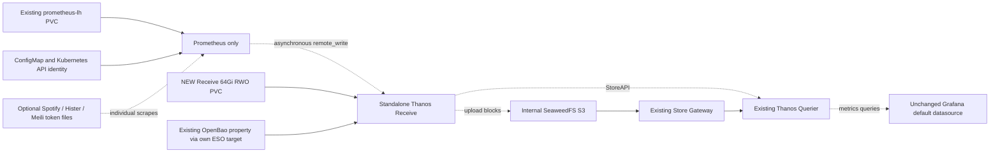

# Prometheus independent of Thanos: staged Receive migration

2026-11-14. **Dual-write enabled live; publication of stage2 pending.** The user selected full
separation through Thanos Receive rather than publishing unready Prometheus
Service endpoints. Infrastructure-stage files are prepared in active Git source
paths and were published through `17b9bd76`, including the storage-quota fix.
Prometheus still runs with its sidecar. Stage2 sources now match the live
remote_write/Receive scrape/extra alerts and Query endpoint changes; cutover
remains inactive. No Secret/PVC deletion or TSDB export was performed.

## Current transition state

On 2026-11-14 the user authorized dual-write activation. Only Argo applications
`kubernetes-prometheus` and `thanos` have temporary `skip-reconcile=true` until
the stage2 source diff is published. Their auto-sync/self-heal specifications
are preserved. Remove these annotations after verifying the published revision;
do not remove the sidecar during this publication step.

The ConfigMap update triggered the expected Recreate restart through Reloader;
Prometheus and its sidecar recovered together, Query recovered with both store
paths, and Receive was not restarted. Initial live checks: over2million samples
sent, failed samples0, Receive scrape up1, delivery lag about23seconds. Query
returns two copies of Prometheus's `up` with `dedup=false` and one with dedup,
and a replica selector confirms fresh data from `thanos-receive-0`. Signed
list/read from Receive to internal S3 passed in the infrastructure stage.

These checks do not establish the natural Receive block upload or historical
continuity required below. Keep dual-write and sidecar while observing memory,
queue progress, the first natural two-hour block cycle and Store Gateway reads.
Initial working-set readings were about4863Mi for Prometheus (limit6400Mi) and
3436Mi for Receive (limit6Gi); these are early observations, not steady-state
sizing guarantees. No receiver outage or real Secret deletion was injected.

## Intended graph



Prometheus retains normal startup/readiness/liveness probes and a normal
readiness-filtered Service. There is no publishNotReadyAddresses workaround.
No second Pod mounts `prometheus-lh`; no affinity-dependent RWO sharing, RWO→RWX
conversion, new writer to its TSDB, or NFS-backed Prometheus storage is introduced.
The new receiver has its own StatefulSet, retained PVC and independent lifecycle.

The three scrape Secrets become optional projections only at the final stage.
Their auth configuration stays unchanged: missing/invalid files produce failed
individual scrapes and existing alerts, never an unauthenticated fallback. New
files/rotation recover without a Prometheus process restart. ConfigMap, TSDB and
Kubernetes service-account credentials remain mandatory; local OpenBao CA
ConfigMap remains for its HTTPS scrape. S3 config is removed from the Prometheus
Pod entirely and exists only in the Receive Pod.

## Generate reviewable stages

```sh
python3 tools/bootstrap/prepare_prometheus_receive.py \
  --stage infrastructure --output /tmp/prom-receive-infrastructure-NEW
python3 tools/bootstrap/prepare_prometheus_receive.py \
  --stage dual-write --output /tmp/prom-receive-dual-write-NEW
python3 tools/bootstrap/prepare_prometheus_receive.py \
  --stage cutover --output /tmp/prom-receive-cutover-NEW
```

Each directory must be new and outside Git. It contains full candidate files at
their eventual source paths plus source hashes in index.json. The generator
never contacts Kubernetes or overwrites active sources. Compare hashes and
regenerate after source changes; do not copy an old complete ConfigMap over a
newer rules/config update. Stages can be regenerated after the prior stage is
promoted. The additional validation/ subtree is only for CI resource checks, never a source
promotion target; index.json lists the actual candidate paths.
Staging/committing/runtime application require their own authorization.
Do not publish all stages as one atomic transition.

### 1. Infrastructure and admission

The first published rollout (`e8125250`) hit namespace storage admission:
monitoring used 219Gi of its 260Gi quota, leaving less than Receive's 64Gi claim.
The prepared correction raises only monitoring's storage quota to 324Gi,
preserving the old budget plus the independent claim. No existing PVC is resized.
Publish this correction before continuing acceptance; check ResourceQuota usage
as well as Longhorn capacity. Prometheus remains on its unchanged sidecar Pod.

New singleton Receive uses the existing declared Thanos version, namespace
`monitoring`, 2Gi memory request /6Gi limit, 100m CPU request, new 64Gi Longhorn
claim, three-day local retention and two-hour blocks. The new claim survives
StatefulSet deletion/scale-down. Current StorageClass uses two replicas (roughly128Gi scheduled logical capacity
for the new64Gi claim); recheck disk headroom and node allocatable capacity before
allocating it. Read-only preflight found at least653Gi available on each listed
Longhorn disk, with larger disks also available. No claim was allocated. Read-only
baseline: shared Prometheus Pod used about 4.6Gi; monitoring permits up to8Gi per
container. Receiver TSDB plus remote-write series cache adds memory/storage load;
these figures are initial review budgets, not a production sizing benchmark.

New ESO target `thanos-receive-objstore-internal` derives the existing OpenBao
`monitoring/objstore.yml`, using the same guarded template, bucket and internal
endpoint as current clients. No credentials are embedded or exported. Missing
S3 Secret can block Receive, never Prometheus. S3 service outage with valid
config is an upload failure domain; do not add an S3 startup gate.

Policies permit Prometheus→Receive HTTP19291/metrics10902, Query→Receive gRPC10901,
and Receive→SeaweedFS TCP8333; namespace DNS policy already applies. Receiver is
excluded from generic intra-namespace egress. Seaweed ingress and Query egress
are extended narrowly; the explicit Argo NetworkPolicy filename allowlist is
updated. Receiver is also excluded from generic monitoring ingress, so additive
policies cannot silently reopen remote-write to every monitoring Pod. No public ingress, unauthenticated Internet endpoint or hash ring is
introduced. Singleton local-ingestor mode requires no peer replication port.
The HTTP tenant header is trusted only within the scoped monitoring path; this
is not an authenticated multi-tenant ingestion service.

Before changing Prometheus: require policy adoption, mounted S3 config, Receiver
readiness, an authorized signed S3 check and enough capacity. No existing
Prometheus manifest/config/query endpoint changes in this stage.

### 2. Dual write and history acceptance

Add asynchronous remote_write plus a Receive scrape target, retaining old
sidecar and both Query endpoints. Keep all old alert rules; add lag and dropped-
sample alerts for the named queue. Existing ConfigMap Reloader can restart the
single Recreate Pod when the ConfigMap changes: plan a brief monitoring window,
keep alert evaluation external expectations explicit and use narrowly scoped
maintenance silences. This is not claimed to be restart-free config activation.

Identity is deliberately unchanged: existing Prometheus external label
`cluster="prometheus"` is also the receiver tenant label (`--receive.tenant-label-name=cluster`,
`--receive.default-tenant-id=prometheus` and fixed sender tenant header). The
receiver adds only `replica`, which the existing Query already deduplicates.
Do not add an unrelated tenant_id/receive label or change the Query default,
datasource UID or dashboards. Local exact-image dual StoreAPI query verified
count2 without dedup and count1 with dedup for identical samples.

**Do not remove the sidecar yet.** Acceptance must include:

* Remote-write highest-sent timestamp advances, retries/backlog drain and no
  rejected/dropped samples. Verify actual queue metrics on the deployed version.
  Observe Prometheus RSS/cardinality and Receiver memory under real load: the
  sender adds a series cache even with bounded shards. Require headroom within
  unchanged Prometheus limits; review sizing before cutover if pressure appears.
* Query finds fresh receiver data with `dedup=false`/replica selector; common
  queries with dedup enabled do not double-count old/new streams.
* A natural Receive two-hour block upload completes through internal S3, then
  the same data is queryable through Store Gateway. A Ready Pod or signed list
  alone does not prove ingestion/upload/history continuity.
* Compare closed local Prometheus block ULIDs with shipper uploaded bookkeeping
  and object-store metadata. Verify representative old/recent range queries,
  oldest local time range and the boundary where remote_write began.
* Retain overlap for at least one natural block cycle and sufficient scrape/WAL
  coverage. remote_write is not a bulk backfill of all three days of local data.
  Never delete unshipped blocks or assume the latest WAL covers old blocks.

Read-only current-source baseline: sidecar upload counter5, failures0; shipper
records36 uploaded blocks. This closes the earlier natural-sidecar-upload check,
not the future Receive upload check. Recheck inventories at actual transition.
If any local closed block is unshipped, stop the migration before cutover and
finish the existing shipper path or separately review a read-only backfill plan.
No automatic TSDB rewrite, bucket rewrite or sensitive export is prepared here.

### 3. Detach the sidecar

Only after stage2 acceptance promote cutover: remove Thanos container, S3 and
unused shared mounts from the Prometheus Pod; mark just the three scrape token
projections optional. Preserve Prometheus image/args/limits/retention, all probes,
permissions init, TSDB claim, ServiceAccount and API auth. Preserve ordinary
Prometheus Service readiness. Query retires only the sidecar endpoint; expected
scrape-job recording changes from sidecar to Receive, with all other alerts
preserved. This is another planned Recreate rollout.

Require local collection, alerts and API/UI when Receive is independently
unavailable; optional credential absence/recovery must affect only its scrape.
Do not stop production providers or delete real Secrets merely to test this;
use the isolated fixture first and separately authorize any live failure test.
Existing sidecar headless Service and original ESO target may remain as rollback
artifacts; deletion is a separate final cleanup after no consumers reference them.
No PVC, S3 object, existing backup or compactor retention rule is deleted/changed.

## Limits and rollback

Prometheus remote_write normally retries from its WAL, but a long receiver outage
can exceed its replay window: official documentation warns about loss of unsent
remote data after roughly two hours. The three-day local TSDB is still available
for local queries and a separately reviewed recovery; it is not an unlimited
remote-write queue. Four maximum shards bound queue overhead; do not hide backlog
or dropped-sample alerts. A singleton Receive is not HA. S3/Receive failure no
longer prevents Prometheus starting, but it can impair Thanos/Grafana recent
queries. A direct Prometheus datasource/failover UI is a separate optional change.

Rollback by stage, preserving all volumes and object-store contents:

1. Before dual-write: leave the independent Receiver idle, restore only new
   query/policy entries if necessary. Retain its claim for inspection.
2. During dual-write: revert only remote_write/extra scrape/rules/Query additions,
   keeping old sidecar, app auth and main TSDB unchanged. Inspect queue/backlog
   before removing the sender config; already received samples remain retained.
3. After cutover: restore the previous same-Pod sidecar/mount/Secret references
   through a controlled Recreate rollout. Restore Query's old endpoint and scrape
   job expectation together. Preserve all later image/security changes. Keep
   Receive and its TSDB, initially keep remote_write if needed for continuity;
   do not detach its data or roll back database/schema/object-store contents.
4. Recheck Prometheus readiness, Query labels/coverage, queues and uploads; expire
   all maintenance silences and restore affected Argo reconciliation only after
   desired Git matches live. Never force PVC detach or run competing TSDB writers.

## Validation

`tests/test_prometheus_receive_preparation.py` covers phase separation, unchanged
local Prometheus contracts/old rules, optional Secret scope, own retained storage,
labels, guarded idempotent generation and narrow network/Argo adoption. CI renders
and schema/resource-validates all three inactive stages; no candidate is activated.

Opt-in real binaries on disposable data:

```sh
python3 tools/security/test_prometheus_receive.py
```

Needs Podman plus the declared Prometheus/Thanos images and Python3.14-slim fixture
image locally available. The script uses a no-uplink shared network namespace,
synthetic bearer/basic files and fresh named volumes. It verifies boot/rule
execution without Receive/credentials, file appearance/rotation/removal, real
remote_write and dual StoreAPI dedup, Receive stop/start and fresh-sample recovery,
with unchanged Prometheus process start time. It removes only its own objects.
It neither contacts Kubernetes nor uses any production Secret/PVC/S3 bucket.
S3 upload, Kubernetes admission/policy enforcement and full transition remain
separate live acceptance gates; none are inferred from these local tests.

References: [Thanos Receive](https://thanos.io/tip/components/receive.md/),
[pinned0.42.5 receiver implementation](https://github.com/thanos-io/thanos/blob/v0.42.5/cmd/thanos/receive.go),
[Prometheus remote-write limitations](https://prometheus.io/docs/practices/remote_write/).

### Prepared acceptance record

All current Prometheus Deployment/ConfigMap/Service bytes remain unchanged in
this working tree. Only infrastructure-stage runtime files and their network
integration are prepared; no cluster resource was changed. Current Prometheus
and Thanos Argo apps remain Healthy/Synced, and no live Receive StatefulSet exists.
The broad Argo verifier also observed an unrelated open-terminal/root-application
rollout during this task; those applications were not modified here.

Local checks: repository unit suite780 passed (16 skips); exact-image fixture passed all
four fault-matrix stages. The lazy dropped-sample CounterVec was exercised using
a separate synthetic sample-age-drop queue, not a production drop policy. Source
sender metrics and label names were checked against the actual binary.
All three stages passed strict Kubernetes schemas (no errors) and resource
checks, plus six installed Application/ExternalSecret CRD spec validations. The
real declared-image promtool accepted all three configs and all187 baseline rules
(189 with the two additional sender alerts); no old alert was weakened.
Actual active-source rendering of the five related applications passed resource
checks (16 containers). CI performs equivalent inactive-stage validation and
normal active-source rendering. Live S3 upload/admission/history acceptance
remains pending, explicitly bounded by the transition gates above.
